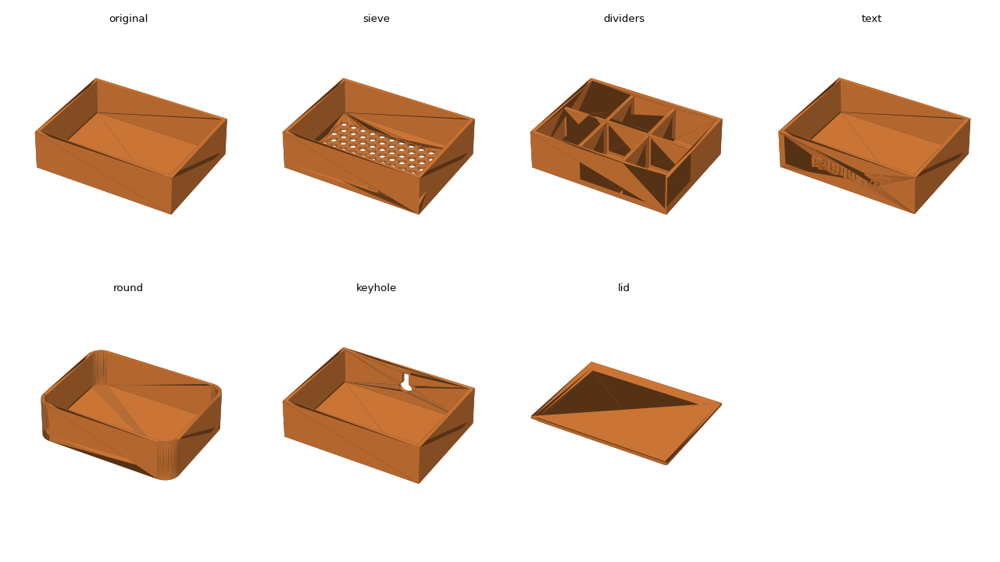

# From Prompt to Print: 3D Printing with Claude for CAD

Build-along session at the Build with AI Club x Claude Community Ambassadors event,
SF Tech Week, Saturday October 10, 2026.

In 45 minutes you build an open-top box in Tinkercad, export it as an STL, hand the
STL to Claude, and have Claude write and run the code that turns it into something
you could not easily click together: a sieve, a divided organizer, a box with your
name on it, a lid, a hanging slot. You leave with a print-ready file.

No CAD background, no printer, nothing to install.



## Before you arrive

A laptop with Chrome, a free [Tinkercad](https://www.tinkercad.com) account you have
signed into once, and a [claude.ai](https://claude.ai) account with **Code execution
and file creation** on under Settings > Capabilities (on by default; event credits or
your own Pro plan). No GitHub account needed to use this repo.

## What is here

| File | What it is for |
| --- | --- |
| [attendee-guide.md](attendee-guide.md) | The half-page guide: steps, prompt, and what "done" looks like |
| [STARTER_PROMPT.md](STARTER_PROMPT.md) | The prompt to paste into Claude, the menu of changes, follow-ups that work |
| [examples/box_80x60x30.stl](examples/box_80x60x30.stl) | Catch-up file: the Build 1 box, if you fall behind in Tinkercad |
| [examples/](examples/) | One finished example per menu item, so you know what to expect |
| [tools/modify_stl.py](tools/modify_stl.py) | Reference code for every menu change, the kind Claude writes for you |

## The two builds

**Build 1 (Tinkercad, 10 min).** Box, then a second Box set to Hole, 4 mm smaller
in width and depth, raised 2 mm. Align, group, export as STL. You choose the size
and what it holds.

**Build 2 (Claude, 12 min).** Attach the STL, paste the starter prompt, pick one
change from the menu. Claude measures the box, makes the change with real geometry
operations, checks that it will print, and gives you the new STL to download.

## Running the reference code yourself (optional)

```bash
pip install -r tools/requirements.txt
python tools/modify_stl.py examples/box_80x60x30.stl info
python tools/modify_stl.py examples/box_80x60x30.stl sieve --hole 4 --pitch 6
python tools/modify_stl.py examples/box_80x60x30.stl dividers --cols 3 --rows 2
python tools/modify_stl.py examples/box_80x60x30.stl text --text "SEAN"
python tools/modify_stl.py examples/box_80x60x30.stl round --radius 8
python tools/modify_stl.py examples/box_80x60x30.stl lid
python tools/modify_stl.py examples/box_80x60x30.stl keyhole
```

Each run prints a before/after report (size, volume, triangles, watertight) and
writes `<name>_<change>.stl` next to the input.

## Printability rules of thumb

- Walls at least 1.2 mm (2 mm is comfortable).
- Holes at least 2 mm wide; smaller ones close up.
- Overhangs under 45 degrees, or add supports.
- Put the flattest face down. A box prints floor-down with no supports.
- Fits need clearance: 0.2 to 0.4 mm per side for a drop-in lid.
- The STL must be watertight (a closed surface), or the slicer will complain.

## Getting it printed

Any library makerspace, a friend with a printer, or an online print service takes a
plain STL. Free slicers (Bambu Studio, PrusaSlicer, Cura) show you a layer preview
and a print time before you commit.

## License

MIT, see [LICENSE](LICENSE).

<!-- Before you push: replace YOUR-HANDLE in attendee-guide.md, put your name in
     LICENSE, and delete this comment. -->
